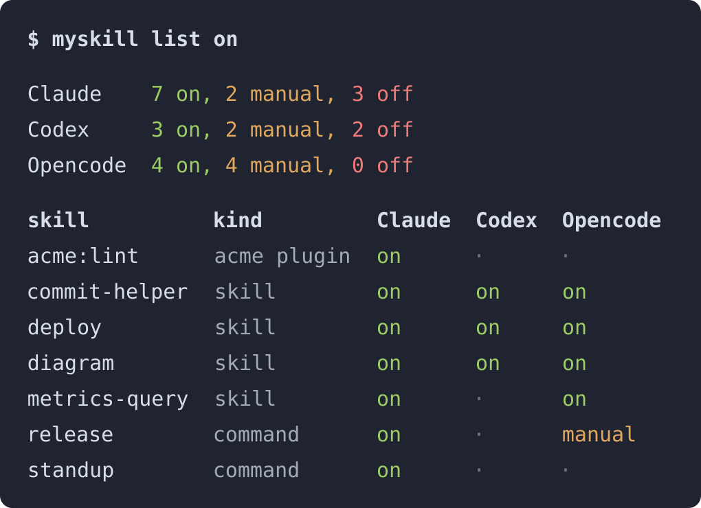
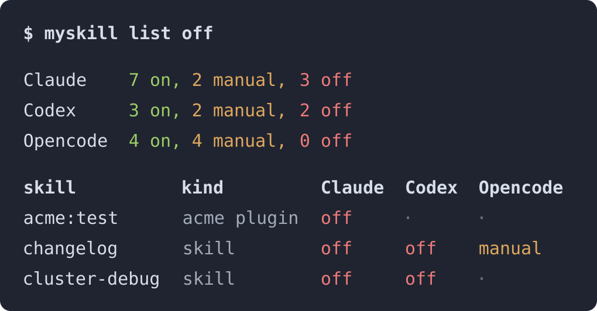

# myskills

**Одна команда включает скил, прячет его от модели или выключает. Сразу в
Claude Code, Codex и Opencode, и в каждой IDE — её собственной настройкой.**

**Работает прямо из терминала.** `myskill` — это CLI: его запускают в любом
терминале, не открывая ассистента и не начиная сессию. Скил `/myskill`
(`$myskill` в Codex) — дополнительная возможность: он вызывает тот же CLI,
если удобнее попросить ассистента.

Каталоги скилов `myskill` не переносит и своего состояния не хранит:
состояние лежит в `settings.json`, `config.toml` и `opencode.json`, там, где
его читает сама IDE.

**Некогда читать?** → [Быстрый старт](FAST-START.RU.md) · [Fast start](FAST-START.md)

[English version](README.md) · Как каждая IDE хранит состояние:
[по-русски](docs/how-it-works.ru.md) · [English](docs/how-it-works.en.md)

---

## Зачем нужен myskills

Каждый скил, который показан модели, добавляет своё имя и описание в контекст
каждой сессии. Часть скилов нужна раз в месяц. Часть на этой машине не
заработает вовсе: нет переменной или программы, без которой они не работают.

Выключить скил умеет каждая IDE, но каждая по-своему:

| IDE | Выключить | Спрятать от модели, оставив вызов вручную |
|---|---|---|
| Claude Code | `skillOverrides` в `settings.json` | `"user-invocable-only"` |
| Codex | `[[skills.config]]` в `config.toml` | `agents/openai.yaml` в каталоге скила |
| Opencode | нечем | `permission.skill` `deny` в `opencode.json` |

К тому же каждая IDE называет скил по-своему, и запись под чужим именем ничего
не делает. Труднее всего со скилом плагина: на него Claude Code
`skillOverrides` не применяет. `myskill` учитывает все эти различия, поэтому
одна команда даёт одинаковый результат во всех трёх IDE.

## Что внутри

| Файл | Что делает |
|---|---|
| `bin/myskill` | CLI: `list`, `on`, `manual`, `off`, `deps`, `unusable`, `probe`, `apply` |
| `skills/myskill/SKILL.md` | необязательный скил, который вызывает CLI из сессии: `/myskill` в Claude Code и Opencode, `$myskill` в Codex |
| `commands/myskill.md` | команда `/myskill` для Opencode |
| `requires.example.json` | шаблон `requires.json`: что нужно каждому скилу для работы — переменные, программы, MCP-серверы |
| `lib/wire.py` | подключает хук `SessionStart` `myskill apply` в Claude Code и Codex |
| `install.sh` | копирует всё перечисленное и подключает хук |
| `lib/skillfiles.sh` | решает, совпадает ли установленный каталог скила с этим клоном; его читают `install.sh` и `release.sh` |
| `release.sh` | проверяет, что changelog, тег и установленные копии сходятся |
| `tests/` | `test_myskill.sh` для CLI, `test_install.sh` для установщика; оба работают во временном `HOME` |

## Установка

Linux или macOS, `python3` версии 3.8 и новее.

```bash
git clone <этот-репозиторий> myskills
cd myskills
./install.sh --dry-run    # что изменится
./install.sh              # во все IDE, найденные в $HOME
```

Что куда попадает:

| Путь | Что |
|---|---|
| `~/.local/bin/myskill` | CLI |
| `~/.local/share/myskill/requires.json` | реестр того, что нужно скилам, если он есть в клоне |
| `~/.claude/skills/myskill/`, `~/.codex/skills/myskill/`, `~/.config/opencode/skills/myskill/` | скил |
| `~/.config/opencode/commands/myskill.md` | команда Opencode |
| `~/.claude/settings.json`, `~/.codex/hooks.json` | хук `SessionStart` `myskill apply` |

Повторный запуск `install.sh` ничего не меняет. Файл или каталог скила,
который он заменяет, сначала копируется в `~/.local/state/myskill/backups/` —
вне всех каталогов, которые читают IDE; другой каталог задаёт
`MYSKILL_BACKUP_DIR`. Уже существующая запись хука с программой `myskill`
остаётся как есть и не дублируется. Если вы выполнили
`myskill manual myskill`, записанный этой командой файл Codex остаётся
после переустановки. Ключ
`--ide claude|codex|opencode` ограничивает запуск одной IDE.

После установки перезапустите IDE: скилы и хуки читаются при старте.

## Как пользоваться

Запускайте CLI в любом терминале, ассистент для этого не нужен. Имена скилов
ниже — примеры; настоящие имена показывает `myskill list`.

```bash
myskill list                    # строка на скил, столбец на IDE
myskill list off                # выключенные хотя бы в одной IDE
myskill list deploy             # строки, в имени которых есть "deploy"
myskill manual diagram review   # спрятаны от модели, /diagram по-прежнему работает
myskill off acme:lint           # скил плагина, в виде <plugin>:<skill>
myskill on diagram              # вернуть как было по умолчанию
myskill deps notes              # кому он нужен: хуки, правила, другие скилы
myskill unusable                # скилы, которые на этой машине не заработают
```

`myskill list on` и `myskill list off` показывают строки, где это состояние
есть хотя бы в одной IDE. Счётчики сверху всегда считают все скилы:

[](docs/list-on.png)

[](docs/list-off.png)

Можно и попросить ассистента: «отключи deploy», «скрой от модели diagram»,
«что зависит от notes». Скил выполнит те же команды.

### Состояния

| Состояние | Модель берёт сама | Вы вызываете | Claude Code | Codex | Opencode |
|---|:---:|:---:|---|---|---|
| `on` | ✅ | ✅ | `/name` | `$name` | `/name` |
| `manual` | ❌ | ✅ | `/name` | `$name` | `/name` или `/skills` |
| `off` | ❌ | ❌ | — | — | невозможно: становится `manual` |
| `·` | | | в этой IDE скил не установлен | | |

В столбцах IDE — как запустить скил вручную.

Особые случаи:

| Что | Claude Code | Codex | Opencode |
|---|---|---|---|
| скил плагина | `manual` даёт `off` | `manual` даёт `off` | как в таблице |
| команда | как в таблице | команд нет: `·` | всегда `manual`: команду модель не видит |

Любое изменение подхватывается в новой сессии, а не в текущей.

## Безопасность

- **`off` и `manual` не трогают скил, который кому-то нужен.** `myskill` ищет
  имя в хуках, правилах и других скилах, печатает каждую найденную строку и
  завершается с кодом 1. Добавляйте `--force`, только прочитав эти строки.
- **Перед изменением файл копируется.** `settings.json`, `config.toml` и
  `opencode.json` сначала копируются в `~/.local/state/myskill/backups/`;
  хранятся три копии каждого.
- **Чужой файл не трогается.** `agents/openai.yaml`, который записал не
  `myskill`, остаётся как есть, и `manual` об этом сообщает.
- **Испорченный JSON не трогается.** `myskill` останавливается и называет файл.
- **`opencode.json` с комментариями читается, но не перезаписывается.**
  Opencode читает этот файл как JSONC, а запись обратно в JSON стёрла бы
  комментарии. Поэтому `off` и `on` печатают запись, которую нужно добавить
  или убрать вручную.
- **Символическая ссылка на файл настроек остаётся ссылкой.** Изменение
  попадает в файл, на который она указывает, и dotfiles-репозиторий его видит.

## Что нужно скилу

В `requires.json` записано, что нужно каждому скилу для работы.
`myskill unusable` читает его и печатает скилы, которые на этой машине не
заработают. Файл ваш и в git не попадает: возьмите за основу
`requires.example.json` и впишите свои скилы.

```bash
cp requires.example.json requires.json
```

```json
"metrics-query": { "env": ["METRICS_URL"] }
```

| Ключ | Значение |
|---|---|
| `env` | должны быть заданы все переменные |
| `env_any` | должна быть задана хотя бы одна переменная |
| `bin` | все программы должны быть в `PATH` |
| `mcp` | все MCP-серверы должны быть в `~/.claude/mcp.json` или `~/.claude.json` |
| `note` | условие, которое программой не проверить; печатается, чтобы решили вы |
| `{}` | проверено: здесь скилу ничего не нужно |

`myskill probe` читает каждый скил Claude Code и предлагает записи для тех,
которых в `requires.json` ещё нет. Сам он ничего не пишет. При старте новой
сессии `myskill apply` один раз называет эти скилы.

Реестр `myskill` берёт из `MYSKILL_REQUIRES`, иначе из клона, из которого он
запущен, иначе из `~/.local/share/myskill/requires.json`. Правьте файл в
клоне, потом запускайте `./install.sh`.

## Чего myskills не делает

- Не удаляет и не переносит каталог скила. Чтобы удалить скил, удалите его тем
  инструментом, который его установил.
- Не включает и не выключает MCP-серверы, плагины и хуки.
- Не меняет текущую сессию. Новое состояние IDE прочитает при старте следующей.
- Не считает токены. `myskill list` печатает число скилов в каждом состоянии,
  а не их стоимость.

## Переменные окружения

| Переменная | По умолчанию | Что задаёт |
|---|---|---|
| `MYSKILL_CANON` | `~/ai-config-source`, если в нём есть `skills/`; иначе не задан | репозиторий, из которого копируются ваши установленные каталоги скилов, если такой есть; файл `manual` для Codex пишется и туда. Задайте, если скилы приходят из другого каталога |
| `MYSKILL_REQUIRES` | см. [Что нужно скилу](#что-нужно-скилу) | файл реестра |
| `MYSKILL_BACKUP_DIR` | `~/.local/state/myskill/backups` | куда копируются файлы настроек перед изменением |
| `MYSKILL_NO_PROBE` | не задана | если задана, `myskill` не запускает `codex plugin list` и `opencode debug skill`; её задают тесты |
| `CLAUDE_CONFIG_DIR`, `CODEX_HOME`, `XDG_CONFIG_HOME` | `~/.claude`, `~/.codex`, `~/.config` | где каждая IDE хранит настройки |

## Как присылать правки

Перед коммитом прогоните оба набора тестов:

```bash
bash tests/test_myskill.sh
bash tests/test_install.sh
```

Любая правка документации идёт на обоих языках: `README.md` и `README.RU.md`,
`FAST-START.md` и `FAST-START.RU.md`, два файла в `docs/`. Сообщение коммита
пишется по-английски, с телом, которое объясняет причину.

Выпуск версии: переименуйте `## Unreleased` в `CHANGELOG.md` в номер версии с
датой, закоммитьте, запустите `./release.sh tag`, затем `./install.sh`.
`./release.sh check` называет пропущенный шаг.

## Лицензия

MIT, см. [LICENSE](LICENSE).
